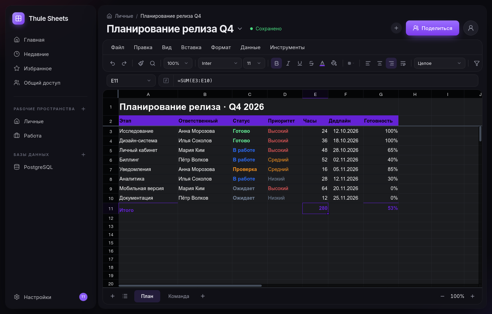
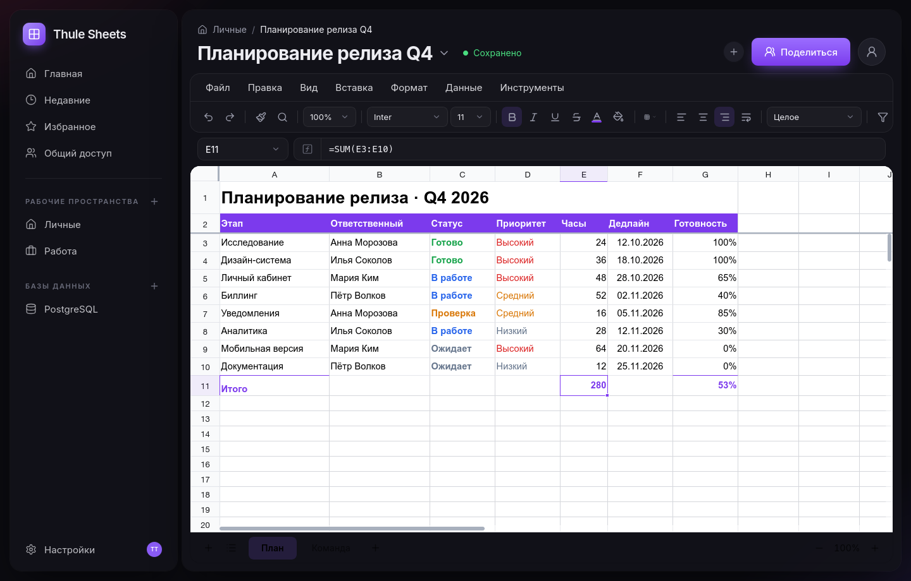

<h1>Thule Sheets</h1>

<strong>Таблицы, в которых приятно работать командой.</strong>

Совместный редактор таблиц в стиле macOS: тёмная тема, знакомые формулы, 
живое присутствие коллег и рабочая PostgreSQL под рукой.

---

## Один инструмент вместо трёх

Thule Sheets заменяет переписку, вложения и вечное «кто последний сохранял?».
Таблица открывается в браузере, изменения видны всем сразу, а рядом живут
данные из рабочей базы — без переключения между окнами и выгрузками.

## ✨ Возможности

- **Редактор, к которому не нужно привыкать.** Формулы и автопересчёт, числовые
  форматы, стили, границы, объединение ячеек, закрепление, сортировка, фильтры,
  проверка данных, условное форматирование, заметки и ссылки.
- **Команда в одном листе.** Изменения появляются у всех сразу; видно, кто онлайн
  и над какой ячейкой работает.
- **История без страха.** Автосохранения, именованные версии и восстановление
  в пару кликов.
- **Файлы — по делу.** Импорт и экспорт XLSX/CSV: можно принести старую таблицу
  и забрать результат в Excel.
- **PostgreSQL рядом.** Подключите базу, просматривайте таблицы, правьте строки
  по ключу и выполняйте запросы в SQL-консоли.
- **Доступ по ролям.** Владелец, редактор и читатель — у каждого свои права.
- **Тема на выбор.** Приложение остаётся тёмным, а таблица может стать белой —
  переключается в меню «Вид».

## 🖥 Интерфейс

Тёмная тема, аккуратные панели, собственный тулбар и строка формул. Слева —
пространства и базы, сверху — привычные меню, внизу — листы. Ничего лишнего,
что отвлекало бы от цифр.

Белая таблица — тот же документ на светлом холсте:

## 👥 Для кого

Для небольших продуктовых команд, аналитиков и всех, кто ведёт общие таблицы
и хочет держать данные рядом с базой, а не в переписке.

## 🧭 Принципы

- **Меньше шума.** Никаких KPI-панелей и дашбордов — только таблицы, формулы
  и данные.
- **Данные под контролем.** Книги и подключения живут в PostgreSQL, доступ
  ограничен ролями.
- **Знакомые вещи.** Формулы, XLSX и привычные горячие клавиши не требуют
  переучиваться.

---

Thule Sheets · 2026

Технические детали и запуск — в [HANDOFF.md](HANDOFF.md)

