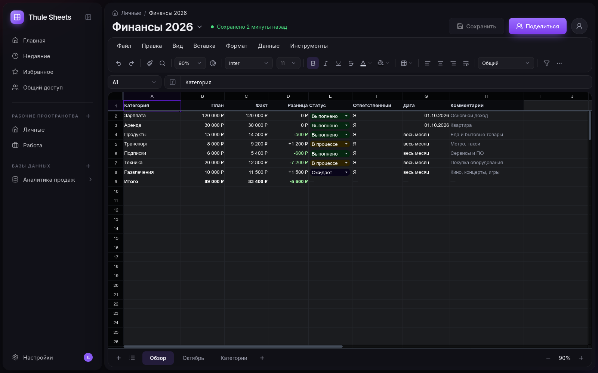
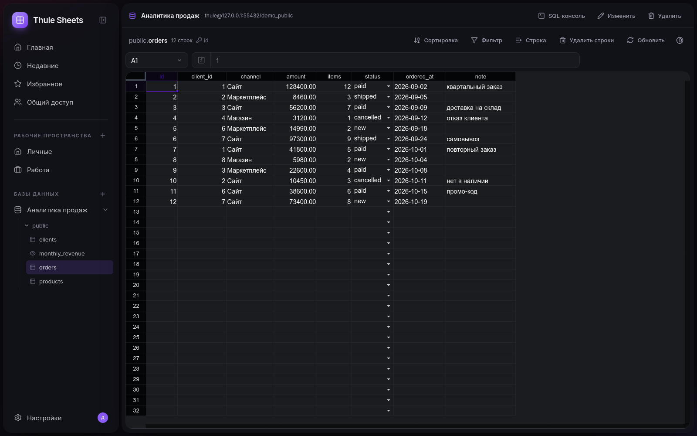

<p align="center">
  
</p>

# Thule Sheets

Таблицы для тех, кто каждый день работает с данными. Знакомый редактор в стиле macOS — и рядом живые таблицы PostgreSQL, без переключения в другой клиент и без выгрузок.

Данные на скриншотах — демонстрационные.



## Что умеет

**Таблицы.** Несколько листов, формулы, числовые форматы, стили, границы, объединение и закрепление ячеек, сортировка, фильтры, проверка данных, условное форматирование, заметки, ссылки, поиск и замена, отмена и повтор действий.

**Доступ и версии.** Рабочие пространства с ролями, доступ к книге по email, история версий и восстановление. Сохранение — явное, по кнопке «Сохранить» или Ctrl+S; если книгу успели изменить в другой вкладке, сервис предложит выбрать версию, а не потеряет правки молча.

**Файлы.** Импорт и экспорт XLSX и CSV.

**PostgreSQL.** Подключение к базе, дерево схем и таблиц, просмотр и редактирование строк с серверной пагинацией, сортировкой и фильтрами, SQL-консоль в режиме только для чтения, вставка результата запроса в лист.



## Документация

- [Спецификация и план разработки](thule-sheets-plan.md) — что делаем и почему именно так.
- [Передача проекта](HANDOFF.md) — текущее состояние, принятые решения, ограничения, оставшиеся задачи.

## Запуск

Нужен Docker.

```bash
cp .env.example .env    # заполните секреты и пароль PostgreSQL
docker compose --profile app up -d --build
```

Приложение откроется на [http://127.0.0.1:8010](http://127.0.0.1:8010). Для локального запуска без HTTPS укажите в `.env` `THULE_ENVIRONMENT=dev` и `THULE_COOKIE_SECURE=false`.

Интерактивная документация API — по адресу `/api/docs`.

Разработка, тесты и описание переменных окружения — в [HANDOFF.md](HANDOFF.md).
